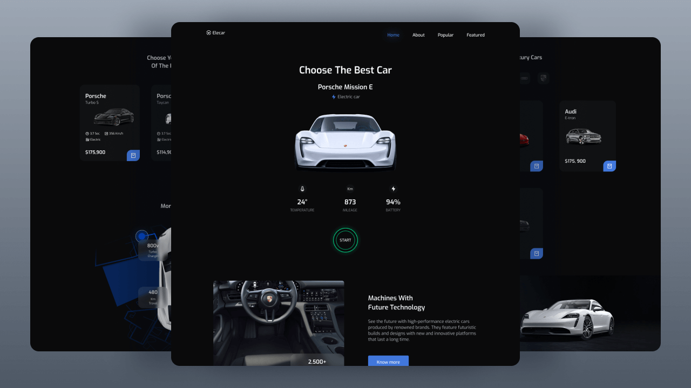
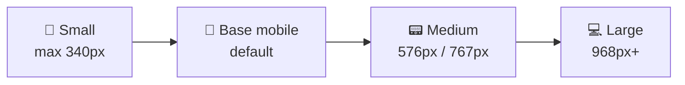
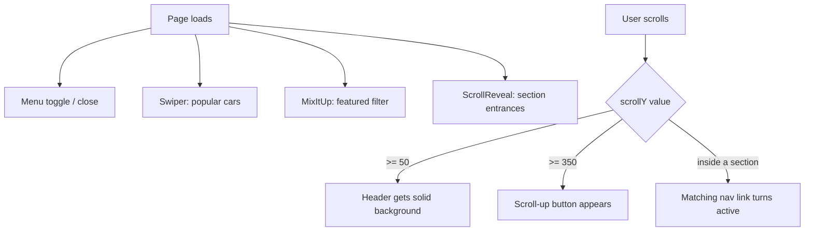

<!-- ============================================================ -->
<!--              Developed by Syed Muhammad Tayyab                -->
<!-- ============================================================ -->

<div align="center">


### ⚡ **Developed by [Syed Muhammad Tayyab](https://github.com/Syed-Muhammad-Tayyab)** ⚡

<a href="https://github.com/Syed-Muhammad-Tayyab/Elecar-Responsive-Car-Website">
  
</a>

<br/>

<p>
  
  
  
  
  
  
</p>

<p>
  
  
  
  
  
  
</p>

<h3>
  <a href="https://syed-muhammad-tayyab.github.io/Elecar-Responsive-Car-Website/">🌐 Live Demo</a>
  &nbsp;•&nbsp;
  <a href="#-features">✨ Features</a>
  &nbsp;•&nbsp;
  <a href="#-quick-start">🚀 Quick Start</a>
  &nbsp;•&nbsp;
  <a href="#-project-structure">🗂️ Structure</a>
  &nbsp;•&nbsp;
  <a href="#-contact">📬 Contact</a>
</h3>

<br/>



</div>

<br/>

---

## 📑 Table of Contents

<details open>
<summary><b>Click to expand / collapse</b></summary>

1. [🚘 About the Project](#-about-the-project)
2. [✨ Features](#-features)
3. [🧩 Page Sections](#-page-sections)
4. [🛠️ Tech Stack](#️-tech-stack)
5. [🗂️ Project Structure](#️-project-structure)
6. [🚀 Quick Start](#-quick-start)
7. [🎨 Design System](#-design-system)
8. [📱 Responsive Breakpoints](#-responsive-breakpoints)
9. [⚙️ How the JavaScript Works](#️-how-the-javascript-works)
10. [🔧 Customization Guide](#-customization-guide)
11. [🌍 Deployment](#-deployment)
12. [🗺️ Roadmap](#️-roadmap)
13. [🤝 Contributing](#-contributing)
14. [🙏 Credits](#-credits)
15. [📜 License](#-license)
16. [📬 Contact](#-contact)

</details>

---

## 🚘 About the Project

**Elecar** is a modern, fully responsive **electric car showcase website** built with nothing but **HTML, CSS and vanilla JavaScript**. It was developed **mobile-first**, then scaled up for tablets and desktops, and presents premium electric vehicles from brands such as **Porsche, Tesla and Audi** in a sleek dark interface.

> 💡 **Why this project?**
> To practise professional front-end fundamentals: semantic HTML, BEM-style CSS naming, CSS custom properties, CSS Grid and Flexbox, scroll-driven animation, touch sliders and content filtering, all without a framework.

<div align="center">

| 🎯 Goal | 🧑‍💻 Audience | 📦 Dependencies |
| :---: | :---: | :---: |
| Showcase electric cars beautifully | Students, front-end learners, portfolio reviewers | 3 small JS libraries, 1 icon font |

</div>

---

## ✨ Features

<table>
<tr>
<td width="50%" valign="top">

### 🎞️ Motion
- 🌊 **Scroll-reveal animations** on every section
- 🧭 **Smooth scrolling** between sections
- 💚 **Pulsing "Start" button** with animated glow ring
- 🪄 **Glass-blur cards** (backdrop filter)

</td>
<td width="50%" valign="top">

### 🧠 Interaction
- 👆 **Touch-friendly Swiper slider** for popular cars (autoplay, pagination, grab cursor)
- 🔀 **MixItUp brand filter** (All / Tesla / Audi / Porsche)
- 📍 **Active-link highlighting** while you scroll
- ⬆️ **Scroll-up button** that appears after 350px

</td>
</tr>
<tr>
<td width="50%" valign="top">

### 📱 Layout
- 📲 **Mobile-first** CSS with 4 breakpoints
- 🍔 **Slide-in mobile menu** with blur background
- 🧱 **CSS Grid + Flexbox** layouts
- 🖼️ **Optimised, scalable images** (`max-width: 100%`)

</td>
<td width="50%" valign="top">

### ♿ Quality
- ⌨️ **Visible keyboard focus** (`:focus-visible`)
- 🐢 **Reduced-motion support** (`prefers-reduced-motion`)
- 🏷️ **ARIA labels** on icon-only buttons
- 🔍 **SEO meta tags** (description, author)

</td>
</tr>
</table>

---

## 🧩 Page Sections


| # | Section | What it shows | Powered by |
| :-: | :-- | :-- | :-- |
| 1 | 🏠 **Home** | Hero car, live stats (temperature, mileage, battery) and the glowing *Start* button | CSS keyframes |
| 2 | ℹ️ **About** | Interior photo, "2.500+ superchargers" glass card, intro text | Grid, `backdrop-filter` |
| 3 | ⭐ **Popular** | Five Porsche electric cars in a swipeable slider | **Swiper** |
| 4 | 🔋 **Features** | Top-down car over a map with 800v / 350 km / 480 km cards | Absolute positioning |
| 5 | 🚗 **Featured** | Tesla, Audi and Porsche cards with brand filter buttons | **MixItUp** |
| 6 | 📧 **Offer** | Special-offers call-to-action over a dark showroom image | Layered images |
| 7 | 🏷️ **Brands** | Porsche, Audi, Tesla, Lamborghini, BMW, Mitsubishi logos | CSS Grid |
| 8 | 🔻 **Footer** | Links, social icons, developer credit | Grid |

---

## 🛠️ Tech Stack

<div align="center">


</div>

| Layer | Technology | Purpose |
| :-- | :-- | :-- |
| 🧱 Structure | **HTML5** | Semantic sections, `header`, `main`, `footer`, `article` |
| 🎨 Styling | **CSS3** | Custom properties, Grid, Flexbox, media queries, keyframes |
| ⚙️ Logic | **Vanilla JavaScript (ES6)** | Menu, header state, scroll spy, filter wiring |
| 🎠 Slider | [Swiper](https://swiperjs.com/) | Touch carousel for popular cars |
| 🔀 Filter | [MixItUp](https://www.kunkalabs.com/mixitup/) | Animated category filtering |
| 🌊 Reveal | [ScrollReveal](https://scrollrevealjs.org/) | Entrance animations on scroll |
| 🔣 Icons | [Remix Icon](https://remixicon.com/) | Icon font loaded from CDN |
| 🔤 Font | [Exo](https://fonts.google.com/specimen/Exo) | Google Fonts display and body face |

---

## 🗂️ Project Structure

```bash
📦 Elecar-Responsive-Car-Website
┣ 📂 .github
┃ ┗ 📂 workflows
┃   ┗ 📜 deploy.yml                # 🚀 Auto-deploy to GitHub Pages
┣ 📂 assets
┃ ┣ 📂 css
┃ ┃ ┣ 🎨 styles.css                # Main stylesheet (variables, sections, breakpoints)
┃ ┃ ┗ 🎨 swiper-bundle.min.css     # Swiper styles
┃ ┣ 📂 img
┃ ┃ ┣ 🖼️ home.png, about.png, features.png, offer.png, offer-bg.png
┃ ┃ ┣ 🚗 popular1-5.png            # Slider cars
┃ ┃ ┣ 🚙 featured1-5.png           # Filterable cars
┃ ┃ ┣ 🏷️ logo1-6.png               # Brand logos
┃ ┃ ┗ 🗺️ map.svg, favicon.png
┃ ┗ 📂 js
┃   ┣ ⚙️ main.js                   # Site logic
┃   ┣ 🎠 swiper-bundle.min.js
┃   ┣ 🔀 mixitup.min.js
┃   ┗ 🌊 scrollreveal.min.js
┣ 📂 docs
┃ ┣ 🖼️ preview.png                 # README preview image
┃ ┗ 📝 content-reference.txt       # Original copy and class-name reference
┣ 📄 index.html                    # Single-page entry point
┣ 📄 README.md                     # You are here 👋
┣ 📄 CONTRIBUTING.md
┣ 📄 LICENSE
┣ 📄 .gitignore
┗ 📄 .nojekyll
```

---

## 🚀 Quick Start

### 📋 Prerequisites
Just a modern browser. No build step, no `npm install`. 🎉

### ⚡ Option 1 · Clone and open

```bash
# 1️⃣ Clone the repository
git clone https://github.com/Syed-Muhammad-Tayyab/Elecar-Responsive-Car-Website.git

# 2️⃣ Enter the folder
cd Elecar-Responsive-Car-Website

# 3️⃣ Open index.html in your browser
#    macOS:   open index.html
#    Windows: start index.html
#    Linux:   xdg-open index.html
```

### 🖥️ Option 2 · Run a local server (recommended)

```bash
# Python 3
python -m http.server 5500

# or Node.js
npx serve .
```

Then visit **http://localhost:5500** 🎯

### 🧰 Option 3 · VS Code Live Server
Right-click `index.html` → **Open with Live Server**. 🔴

---

## 🎨 Design System

All design tokens live in `:root` at the top of `assets/css/styles.css`, so a re-theme means editing a handful of variables.

| 🎨 Token | Value | Use |
| :-- | :-- | :-- |
| `--first-color` | -3d74e0?style=flat-square) | Buttons, active links, accents |
| `--first-color-alt` | -356ad6?style=flat-square) | Button hover |
| `--title-color` | -f1f2f3?style=flat-square) | Headings |
| `--text-color` | -bcc0c8?style=flat-square) | Body text |
| `--body-color` | -0a0a0b?style=flat-square) | Page background |
| `--container-color` | -111213?style=flat-square) | Cards |

**Typography:** `Exo` (400 / 500 / 600). Sizes scale up at `968px` through `--h1-font-size`, `--h2-font-size`, `--normal-font-size` and friends.

---

## 📱 Responsive Breakpoints



| Device | Rule | Highlights |
| :-- | :-- | :-- |
| 📱 Very small phones | `max-width: 340px` | Tighter margins, smaller hero image |
| 📱 Phones (default) | mobile-first base | Slide-in menu, single-column grids |
| 📟 Tablets | `min-width: 576px` / `767px` | 2-column featured grid, inline desktop nav |
| 💻 Desktop | `min-width: 968px` | Side-by-side About and Offer, 3-column grids, 6 logos in a row |

---

## ⚙️ How the JavaScript Works



<details>
<summary><b>📜 Function reference</b></summary>

| Block in `main.js` | Responsibility |
| :-- | :-- |
| `SHOW MENU` / `REMOVE MENU MOBILE` | Opens and closes the mobile nav, and closes it after a link click |
| `scrollHeader()` | Adds `.scroll-header` after 50px of scrolling |
| `swiperPopular` | Configures the centred, looping, autoplay slider |
| `mixerFeatured` + `activeFeatured()` | Filters cards by brand and highlights the active filter |
| `scrollUp()` | Toggles `.show-scroll` after 350px |
| `scrollActive()` | Scroll-spy for the nav links |
| `ScrollReveal` config | Per-element entrance direction, delay and interval |

</details>

---

## 🔧 Customization Guide

<details>
<summary><b>🚗 Add a new car to the Featured filter</b></summary>

1. Copy any `<article class="featured__card mix …">` block in `index.html`.
2. Change the brand class (`tesla`, `audi`, `porsche`) to match a filter button.
3. Put your image in `assets/img/` and update the `src`, title and price.

</details>

<details>
<summary><b>🏷️ Add a new brand filter</b></summary>

1. Add a new `<li>` in `.featured__filters` with `data-filter=".yourbrand"`.
2. Give the matching cards the class `yourbrand`.

</details>

<details>
<summary><b>🎨 Change the colour theme</b></summary>

Edit `--first-color` and `--first-color-alt` in `:root`. Every button, active link and accent updates automatically.

</details>

<details>
<summary><b>🎠 Tune the slider</b></summary>

In `assets/js/main.js`, adjust `spaceBetween`, `autoplay.delay` or the `breakpoints` option of `swiperPopular`.

</details>

---

## 🌍 Deployment

This repo ships with a **GitHub Actions** workflow (`.github/workflows/deploy.yml`) that publishes the site to **GitHub Pages** on every push to `main`.

1. Push the project to GitHub.
2. Go to **Settings → Pages**.
3. Under **Build and deployment**, set **Source** to **GitHub Actions**.
4. Push to `main` and your site goes live at:

```text
https://syed-muhammad-tayyab.github.io/Elecar-Responsive-Car-Website/
```

> Prefer other hosts? The site is 100% static, so **Netlify**, **Vercel** and **Cloudflare Pages** all work by pointing them at the repo root.

---

## 🗺️ Roadmap

- [x] Responsive layout, mobile-first
- [x] Scroll animations and smooth scrolling
- [x] Swiper slider for popular cars
- [x] Brand filter with MixItUp
- [x] Keyboard focus and reduced-motion support
- [ ] 🌗 Light / dark theme toggle
- [ ] 🛒 Working shopping bag with `localStorage`
- [ ] 📧 Real newsletter form with validation
- [ ] 🔎 Search and sort for featured cars
- [ ] 🌐 Multi-language support

---

## 🤝 Contributing

Contributions, issues and feature requests are welcome! See [CONTRIBUTING.md](CONTRIBUTING.md).

```bash
git checkout -b feature/amazing-feature
git commit -m "feat: add amazing feature"
git push origin feature/amazing-feature
```

Then open a **Pull Request** 🎉

---

## 🙏 Credits

- 🎨 Original design and tutorial concept by **[Bedimcode](https://www.youtube.com/c/Bedimcode)**: this project is built on that starter template and design direction.
- 🔣 Icons by [Remix Icon](https://remixicon.com/), fonts by [Google Fonts](https://fonts.google.com/).
- 🎠 [Swiper](https://swiperjs.com/), 🔀 [MixItUp](https://www.kunkalabs.com/mixitup/), 🌊 [ScrollReveal](https://scrollrevealjs.org/) are the property of their respective authors.
- 🚗 Car and logo images belong to their respective brand owners and are used here for **educational and portfolio purposes only**.

---

## 📜 License

The code written for this project is released under the **MIT License**, see [LICENSE](LICENSE). Third-party libraries, images and trademarks keep their own licenses and ownership.

---

## 📬 Contact

<div align="center">

<a href="https://github.com/Syed-Muhammad-Tayyab"></a>

### ⭐ If you like this project, please give it a star! ⭐


</div>
